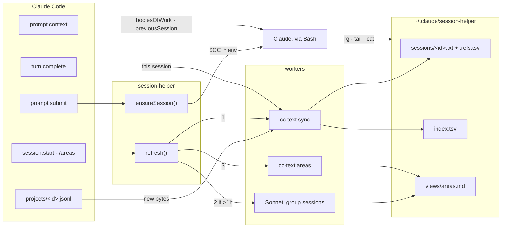

# session-helper

A Claude Code mod that gives every session cheap access to every other session. Claude reads past work with `rg`, `sed` and `tail` instead of parsing raw jsonl, and starts each conversation knowing what you've been working on.

## What it changes in Claude Code

- **Session start:** a `bodiesOfWork` block in the first message, ranking your recent bodies of work, e.g. `- On-call week 12%: handoffs, tickets, runbooks moved into the repo`.
- **Bash environment:** `$CC_HOME`, `$CC_SESSIONS`, `$CC_INDEX`, `$CC_VIEWS` and `$CC_SESSION`, pointing at the text copies.
- **After `/clear`:** a `previousSession` block with the cleared session's last asks and top references, and `$CC_PREV_SESSION` pointing at its transcript.
- **After a compaction:** `bodiesOfWork` again.
- **Slash commands:** `/areas`, to regroup the bodies of work now.
- **CLAUDE.md:** nothing; the section you paste in (see Install) is what tells Claude to use the files.

## What it does

- **Plain-text transcripts.** Every session gets a copy at `$CC_SESSIONS/<id>.txt`, synced after each turn. Every line starts with its role (`you:`, `claude:`, `tool:`, `result:`, `note:`), and line numbers never change, so `file:line` pointers stay valid.
- **References.** Beside each copy, `<id>.refs.tsv` lists the Slack threads, PRs, Linear issues, Notion pages, Granola meetings, artifacts and files the session used, with titles. Keys are normalized, so `rg TRA-2448 $CC_SESSIONS/*.refs.tsv` finds every session that touched one.
- **Bodies of work.** At most once an hour, Sonnet groups the last three weeks of sessions into 4–8 bodies of work. They're ranked locally by typing, active time and output, and the ranking goes into each session's first message.
- **`/clear` pointer.** After a `/clear`, the new conversation gets the cleared session's last asks and what it was using, and `$CC_PREV_SESSION` points at its transcript.

Prompts, tool calls, permissions and compaction are left to the engine; the mod's only other effect is background work. Headless runs (`-p`, SDK scripts) get the env vars and transcripts but no blocks or model calls. A custom compaction built from the text copy lived here until Nov 2026; it's in this repo's history in the commit that imported the mod.

## How it fits together



## When each part runs

| When | What | Cost |
| --- | --- | --- |
| Interactive session starts | Sync all transcripts; regroup if `areas.json` is over an hour old; rank | ≤1 Sonnet call an hour |
| `/areas` | Same, always regroups | 1 Sonnet call |
| Every turn (main loop, not subagents) | Sync this session's text copy and refs | local, incremental |
| Every prompt | Follow the session id; after `/clear`, repoint `$CC_*` and set `$CC_PREV_SESSION` | local |
| First message, and again after a compaction | Add the `bodiesOfWork` block, plus `previousSession` after a `/clear` | local |
| Headless runs (`-p`, SDK scripts) | Env vars and transcript only; left out of the ranking | none |

The desktop app and the VS Code extension drive the engine over the SDK but count as interactive.

## Files and env vars

Everything lives under `$CC_HOME` (default `~/.claude/session-helper`):

| Path | Env var | Holds |
| --- | --- | --- |
| `sessions/<id>.txt` | `$CC_SESSION` (this one), `$CC_SESSIONS` (the folder) | One plain-text copy per session |
| `sessions/<id>.refs.tsv` | | line, compaction, op, kind, key, title |
| `sessions/<id>.meta` | | Sync offset and per-day attention |
| `index.tsv` | `$CC_INDEX` | One row per session, newest first |
| `lineage.tsv` | | child, parent; one row per `/clear` |
| `views/areas.md` | `$CC_VIEWS` | Bodies of work ranked, sessions newest first; `areas.tsv` and `areas.json` beside it |

`views/` is derived and safe to delete. `cc-text` (Python 3, no dependencies) does the file work; run it with no arguments for its commands.

## Install

1. Load the mod in every session, in `~/.claude/settings.json`:

   ```json
   "env": { "CLAUDE_CODE_PLUGIN_DIRS": "/path/to/this/repo/session-helper" }
   ```

2. Tell Claude when to use it. The mod only puts the files in place, and a section like this in `~/.claude/CLAUDE.md` is what makes Claude reach for them:

   ```markdown
   # Efficiently navigating session history

   The `session-helper` mod keeps plain-text copies of every session.
   Use these to navigate session history and gather context, not `~/.claude/projects/*.jsonl`.

   Where things are:
   - `$CC_INDEX`: one row per session, with a header.
   - `$CC_VIEWS/areas.md`: recent bodies of work, ranked by attention, sessions newest first.
   - `$CC_SESSION`: this session's transcript.
   - `$CC_SESSIONS/<id>.txt`: any session's transcript.
   - `$CC_SESSIONS/<id>.refs.tsv`: the Slack threads, PRs, Linear issues, Notion pages, meetings, artifacts and files a session used.
   - `$CC_PREV_SESSION`: the session a `/clear` just ended.

   When to use them:
   - After a compaction, check details in `$CC_SESSION` before trusting the summary: names, ids, numbers, decisions, my wording.
   - After `/clear`, if my ask continues the old session, start with `tail -n 200 "$CC_PREV_SESSION"`.
   - When a task continues earlier work, search that area's sessions before asking me for context.
   - Skip all of this for self-contained tasks.

   How to read them:
   - Every line starts with its role: `you:`, `claude:`, `tool:`, `result:`, `note:`.
   - My asks start `you: [MM-DD HH:MM]`. `rg -n '^you: \[' "$CC_SESSION"` lists them.
   - Line numbers never change.
   - Tool calls and results are cut to one line. Use the raw jsonl only for full tool output.
   - refs.tsv rows: line, compaction, op, kind, key, title.
   - Keys: Slack `channel/ts`, `owner/repo#N`, Linear id, Notion page id, Granola meeting id, artifact id, file path.
   - To find where something came up: `rg <key or title> $CC_SESSIONS/*.refs.tsv`, then read around that line in the `.txt`.
   ```

The first interactive session syncs every existing transcript, which takes a while on a large history; after that each sync is incremental.

## Known gaps

- Edits made through Bash (`sed -i`, here-docs, scripts) count as reads, not edits. Only Edit, Write and NotebookEdit register as edits.
- A new session isn't in any body of work until the next regroup, up to an hour later.
- Repo-less `gh pr view 248` folds into the full PR key only when the session also has that PR's URL; otherwise it shows as `#248`.
